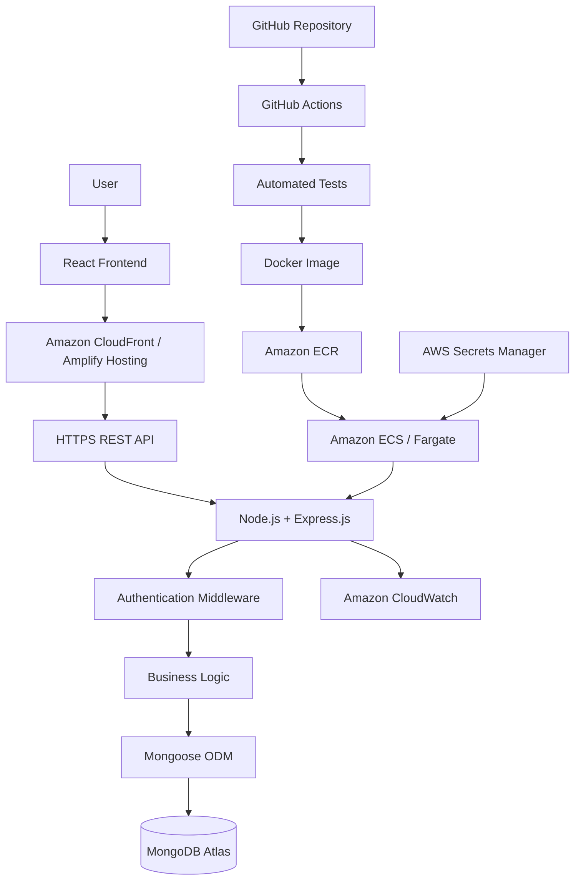

# TaskFlow — Full-Stack Cloud Application

A full-stack project management application built with the MERN stack and deployed on AWS. Features include secure authentication, project management, task tracking, RESTful APIs, containerization, and automated CI/CD.

**React.js · Node.js · Express.js · MongoDB · AWS · Docker · GitHub Actions**

## Architecture



> **Note:** The diagram represents the target architecture. Use only the AWS services you actually deploy.

## Features

* **Authentication:** User registration, login, and protected routes.
* **Project Management:** Create, view, update, and delete projects.
* **Task Management:** Assign tasks, set priorities, and track progress.
* **Dashboard:** Monitor project status and task completion.
* **REST APIs:** Structured endpoints with validation and error handling.
* **Database:** MongoDB persistence using Mongoose.
* **Cloud Deployment:** Host the frontend and backend using cloud infrastructure.
* **Containerization:** Package the backend using Docker.
* **CI/CD:** Automate testing and deployment using GitHub Actions.
* **Monitoring:** Collect application logs and monitor service health.

## Tech Stack

| Category           | Technology                  |
| ------------------ | --------------------------- |
| Frontend           | React.js, JavaScript        |
| Styling            | CSS / Tailwind CSS          |
| Backend            | Node.js, Express.js         |
| Database           | MongoDB Atlas               |
| ODM                | Mongoose                    |
| Authentication     | JWT, bcrypt                 |
| API Testing        | Postman                     |
| Containerization   | Docker                      |
| Cloud Platform     | AWS                         |
| Frontend Hosting   | AWS Amplify Hosting         |
| Backend Deployment | Amazon ECS with AWS Fargate |
| Container Registry | Amazon ECR                  |
| Monitoring         | Amazon CloudWatch           |
| Secrets Management | AWS Secrets Manager         |
| CI/CD              | GitHub Actions              |
| Version Control    | Git, GitHub                 |

## Project Structure

```text
taskflow/
├── client/
│   ├── public/
│   └── src/
│       ├── components/
│       ├── pages/
│       ├── hooks/
│       ├── services/
│       ├── context/
│       ├── App.jsx
│       └── main.jsx
│
├── server/
│   ├── src/
│   │   ├── config/
│   │   ├── controllers/
│   │   ├── middleware/
│   │   ├── models/
│   │   ├── routes/
│   │   ├── services/
│   │   ├── app.js
│   │   └── server.js
│   ├── tests/
│   ├── Dockerfile
│   └── package.json
│
├── .github/
│   └── workflows/
│       └── ci.yml
│
├── .gitignore
└── README.md
```

## Getting Started

### Prerequisites

* Node.js and npm
* Git
* MongoDB Atlas account or a local MongoDB instance
* Docker (optional for local development)

### 1. Clone the Repository

```bash
git clone <your-repository-url>
cd taskflow
```

### 2. Configure the Backend

```bash
cd server
npm install
```

Create a `.env` file inside the `server` directory:

```env
PORT=5000
NODE_ENV=development
MONGODB_URI=your_mongodb_connection_string
JWT_SECRET=your_secure_random_secret
CLIENT_URL=http://localhost:5173
```

### 3. Configure the Frontend

Open a separate terminal:

```bash
cd client
npm install
```

Create `client/.env`:

```env
VITE_API_BASE_URL=http://localhost:5000/api/v1
```

Never expose database credentials or private secrets through frontend environment variables.

### 4. Run the Application

Start the backend:

```bash
cd server
npm run dev
```

Start the frontend in a separate terminal:

```bash
cd client
npm run dev
```

Open the local URL displayed by Vite, normally `http://localhost:5173`.

Ensure the required scripts, database connection, and API routes are implemented before running the application.

## API Endpoints

Base URL: `/api/v1`

### Authentication

| Method | Endpoint         | Description                     |
| ------ | ---------------- | ------------------------------- |
| POST   | `/auth/register` | Register a user                 |
| POST   | `/auth/login`    | Log in                          |
| GET    | `/auth/me`       | Retrieve the authenticated user |

### Projects

| Method | Endpoint        | Description        |
| ------ | --------------- | ------------------ |
| POST   | `/projects`     | Create a project   |
| GET    | `/projects`     | Retrieve projects  |
| GET    | `/projects/:id` | Retrieve a project |
| PATCH  | `/projects/:id` | Update a project   |
| DELETE | `/projects/:id` | Delete a project   |

### Tasks

| Method | Endpoint                     | Description            |
| ------ | ---------------------------- | ---------------------- |
| POST   | `/projects/:projectId/tasks` | Create a task          |
| GET    | `/projects/:projectId/tasks` | Retrieve project tasks |
| PATCH  | `/tasks/:id`                 | Update a task          |
| DELETE | `/tasks/:id`                 | Delete a task          |

Protected endpoints must enforce authentication and resource-level authorization.

## Cloud Deployment

The planned deployment architecture uses:

* **AWS Amplify Hosting:** Host the React frontend.
* **Amazon ECS with AWS Fargate:** Run the containerized backend.
* **Amazon ECR:** Store Docker images.
* **MongoDB Atlas:** Store application data.
* **Amazon CloudWatch:** Collect logs and monitor application health.
* **AWS Secrets Manager:** Store sensitive application configuration.
* **GitHub Actions:** Automate testing, image builds, and deployment.

Configure AWS IAM permissions, networking, HTTPS, database access, and environment variables before deployment.

## CI/CD Pipeline

The GitHub Actions workflow is designed to:

1. Install dependencies.
2. Run linting and automated tests.
3. Build the backend Docker image.
4. Authenticate securely with AWS.
5. Push the image to Amazon ECR.
6. Deploy the updated service to Amazon ECS.
7. Verify deployment health.

The pipeline requires a configured workflow file and appropriate AWS permissions.

## Security

* Hash passwords before storing them.
* Validate incoming API requests.
* Protect private routes with authentication middleware.
* Enforce authorization for project and task operations.
* Use HTTPS in production.
* Keep secrets out of source control.
* Restrict database network access.
* Apply least-privilege IAM permissions.
* Configure rate limiting and appropriate CORS policies.

## Future Improvements

* Real-time collaboration using WebSockets.
* Email notifications.
* File uploads using Amazon S3.
* Infrastructure as Code using Terraform.
* Advanced analytics and reporting.
* Automated integration and end-to-end testing.
* Application performance monitoring.

## Learning Outcomes

This project provides practical experience with:

* Full-stack JavaScript development.
* REST API design and CRUD operations.
* MongoDB data modeling.
* Authentication and authorization.
* Docker containerization.
* AWS deployment and cloud infrastructure.
* CI/CD automation.
* Application monitoring and troubleshooting.

## Author

**Your Name**

Software Engineer | Full-Stack Development | Cloud Engineering

* GitHub: [Your GitHub Profile](https://github.com/er-harshpal/)

## License

This project is available under the MIT License. Add a `LICENSE` file to the repository if you choose to distribute it under that license.
